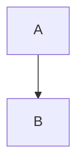

## User

Literal cost \$5 and \$10\. &lt;br&gt; &lt;script&gt;literal&lt;/script&gt; \*\*plain\*\* &#91;&#91;literal&#93;&#93;

Line one\
Line  two

.png?key=1&v=2>)

## Assistant

### Format fixture

Inline \(x_1 + \frac{a}{b}\) and literal \$5\.

\[
\begin{aligned}a&=b\\c&=d\end{aligned}
\]

9. Ninth paragraph\.

   - Nested before code\.

   Paragraph after nested list\.

   ````python
   first = 1

   text = "```"
   ````
10. Tenth paragraph\.

    ```js
      keepIndent();
    next();
    ```

    Still the tenth item\.

- [x] Done task
- [ ] Pending task

> Quoted **bold** and *emphasis*\.

Hard break\
Next line

| Case | Value |
| --- | --- |
| Multiline | First<br>Second |
| Literal HTML | &lt;br&gt; &amp; &lt;b&gt;literal&lt;/b&gt; |
| Pipe | left \| right and `a\|b` |
| Math | \(\frac{a}{b}\) |
| Math pipe | \(|a| + \|b\|\) |

[Balanced URL](<https://example.invalid/a(b)?signed=1&v=two%20words>) and Unsafe label\.

.png?key=1&v=2>)&#91;Image unavailable: Local image&#93;



Fallback \(a\_b+\text{50\% \& x}\)\.